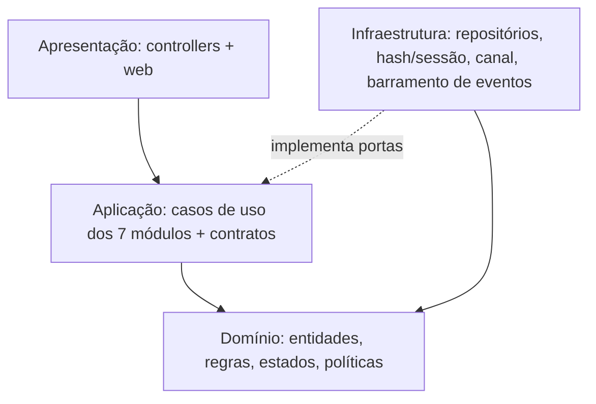

# MVP · Sistema de Agendamento para Clínicas e Consultórios

Protótipo **funcional** da arquitetura descrita no *Documento-Base v0.7* (foco em segurança e LGPD).
Monólito modular em **4 camadas** e **7 módulos**, sem dependências externas (somente JavaScript e Node ≥ 20).

## Como ver funcionando

| Quero… | Comando |
|---|---|
| Abrir a aplicação no navegador | `npm start` → http://localhost:3000 |
| Rodar os testes (unidade, integração e **arquitetura**) | `npm test` |
| Ver os fluxos principais no terminal | `npm run demo` |

**Online (GitHub Pages):** *Settings → Pages → Deploy from a branch → `main` / `(root)`*. O `index.html` da raiz monta o sistema inteiro no navegador (dados em memória, reiniciam ao recarregar).

Usuários de demonstração (senha `senha123`): `ana@demo.br` e `bruno@demo.br` (pacientes), `rita@demo.br` (recepção), `carlos@demo.br` e `lia@demo.br` (profissionais), `admin@demo.br`.

## Estrutura (seção 13.1 do documento)

```
src/
├── presentation/   controllers/ (um por módulo) · web/ (interface)
├── application/    auth · patients · professionals · appointments · clinical-records · notifications · audit
│                   contracts/ (eventos, requests nomeados, portas)
├── domain/         mesmas pastas de módulo + shared/ (entidades, regras, estados, políticas)
├── infrastructure/ persistence/<módulo>/ · identity/ · messaging/ · events/
├── modules.js      manifesto das dependências permitidas entre módulos
└── main.js         raiz de composição (injeção de dependências)
tests/              unit · integration · architecture
```



## Onde cada critério da prova é comprovado

| Critério | Evidência no código |
|---|---|
| **A. Coesão** — responsabilidades bem definidas | 7 módulos com a mesma pasta em `domain/` e `application/`; cada serviço só trata do seu conceito. Dados cadastrais (`patients`) separados dos clínicos (`clinical-records`); horários habituais (`professionals`) separados da disponibilidade efetiva (`appointments`). Teste: *há exatamente os 7 módulos*. |
| **B. Acoplamento** — dependências mínimas | `src/modules.js` declara as dependências permitidas; `main.js` as impõe via injeção (acesso a módulo não declarado lança erro). Teste: *nenhum módulo importa código de outro módulo*, *grafo acíclico*, *direção das camadas*. Comunicação por **contratos** (`summary`, `contactOf`, `habitualSlots`, `hasRelationship`) e **eventos** (`InMemoryEventBus`): Agendamentos não conhece Notificações nem Auditoria. |
| **B. Conascência** (6 tipos) | Ver tabela abaixo. |
| **C.1 Materialização** | Pastas = camadas e módulos do diagrama; `npm run demo` e a interface exercitam os 7 módulos. |
| **C.2 Modularização** | Testes de arquitetura em `tests/architecture/dependencies.test.js`. |
| **C.3 Consistência doc × código** | Nomes do documento no código: `AppointmentCreated`, `CriarAgendamentoRequest`, estados `AGENDADA/CONFIRMADA/CANCELADA/CONCLUIDA`, RBAC + acesso contextual, auditoria sem conteúdo clínico. |
| **C.4 Evolução** | Persistência, canal de notificação e barramento são adaptadores trocáveis (portas em `application/contracts/ports.js`); um módulo pode ser extraído porque só se liga aos outros por contratos/eventos. |

### Conascência

| Tipo | Onde | Tratamento |
|---|---|---|
| **Nome** | Nomes de eventos | `application/contracts/events.js` é a fonte única |
| **Tipo** | Formato dos DTOs/eventos | `contracts/requests.js` valida e congela os objetos |
| **Convenção** | Significado dos estados da consulta | `domain/appointments/status.js` (enum + transições) |
| **Posição** | `CriarAgendamentoRequest` | Campos nomeados em vez de parâmetros posicionais |
| **Execução** | Gravar **antes** de publicar o evento | `AppointmentService.book`; teste: reserva que falha não gera evento |
| **Temporal** | Reservas simultâneas | `reserve()` verifica e grava atomicamente (equivale a `UNIQUE(profissional, início)`); teste com `Promise.allSettled` |

## Segurança e LGPD implementadas

Senha com PBKDF2 + sal e bloqueio após 5 falhas · sessão com token aleatório e expiração · RBAC no backend (`ROLE_PERMISSIONS`) · acesso clínico só com vínculo ativo com o paciente (administrador e recepção nunca acessam) · eventos e auditoria só com identificadores (lista branca) · notificações sem especialidade/diagnóstico · registros clínicos e de auditoria *append-only* · acesso à auditoria também é auditado.

## Limites assumidos (MVP)

Dados em memória (sem banco real) · canal de SMS/e-mail simulado · sem recuperação de senha, política de retenção/descarte, backup e criptografia em repouso · barramento síncrono (para maior robustez, usar *outbox* transacional, como descrito na seção 10.4 do documento) · o paciente ainda não consulta seus próprios dados clínicos (pendência 13.1 do documento).
